# SSCommerce

Teknoloji ve yaşam tarzı ürünleri satan, tek satıcılı bir e-ticaret mağazası. Fiziksel ürün satılır, para birimi TRY'dir. **İlk sürümde gerçek ödeme alınmaz.**

<p align="center">
  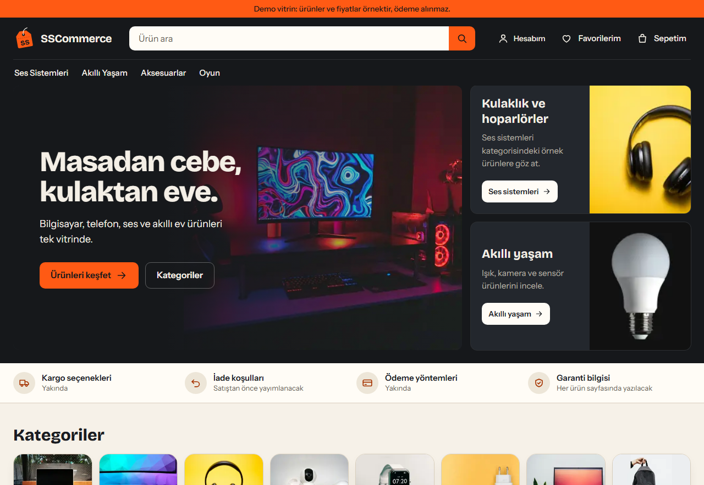
</p>

**Bölümler:** [Vitrin](#vitrin-hesap-açmadan-dene) · [Müşteri tarafı](#müşteri-tarafı) · [Yönetim paneli](#yönetim-paneli) · [Bilinen sınırlar](#bilinen-sınırlar-vitrin) · [Künye](#künye) · [Neden bu yapı?](#neden-bu-yapı) · [Çalıştırma](#çalıştırma-windows-powershell)

## Vitrin: hesap açmadan dene

Giriş sayfasında üç düğme vardır: **Demo müşteri**, **Demo yönetici**, **Demo depocu**. Her biri sabit, örnek veriyle dolu bir vitrin hesabına parolasız oturum açar. Böylece projeyi gezmek için kayıt olmak ya da Admin yetkisi vermek gerekmez.

<p align="center">
  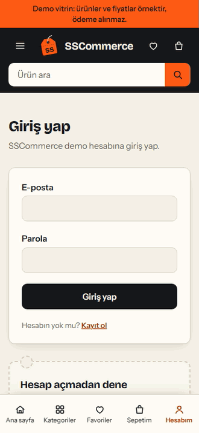
</p>

- **Demo müşteri:** iki adres, altı favori, sepette iki ürün ve gerçek sipariş servisinden geçmiş beş sipariş (alındı, hazırlanıyor, kargoda, teslim edildi, iptal edildi).
- **Demo yönetici:** `/admin` paneli (özet, ürünler, kategoriler, stok, depolar, siparişler, raporlar, kullanıcılar).
- **Demo depocu:** yalnız sipariş ekranları ve ileri durum geçişleri; teslimat adresi ve telefonu görmez (D-071).
- Düğmeler yalnız API'de `Showcase:Enabled=true` ise görünür. Bu ayar **yalnız Development ortamında** açılabilir; Production'da API açılışta reddeder (D-092, D-093). Demo hesapların parolası rastgeledir ve hiçbir yerde saklanmaz; `POST /api/v1/auth/demo` yalnız bu üç sabit e-postayı hedefler, başka kullanıcıya oturum açamaz.

Yerelde açmak (`.\dev -Showcase`: katalog + stok + demo hesaplar kurulur) için aşağıdaki [Çalıştırma](#çalıştırma-windows-powershell) bölümündeki kurulum gerekir. Bu komutun kendisi README için yapılan kayıtlarda **çalıştırılmadı** (bkz. [Künye](#künye)).

## Müşteri tarafı

<p align="center">
  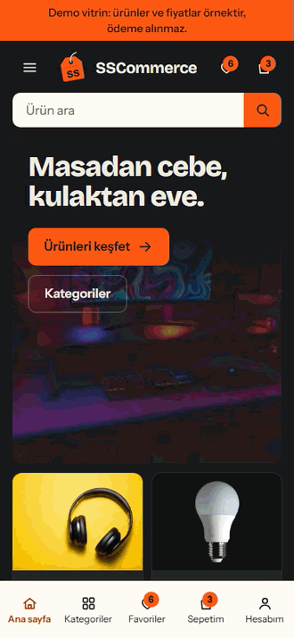
</p>

Kategori → ürün → sepet → teslimat özeti → sipariş. **Ödeme alınmaz**: sipariş ödenmemiş bir kayıt olarak oluşur, kargo ve genel toplam hesaplanmaz, stok sipariş anında düşer. Tutarları sunucu güncel fiyattan hesaplar; arayüz iş mantığı içermez.

<table>
  <tr>
    <td align="center">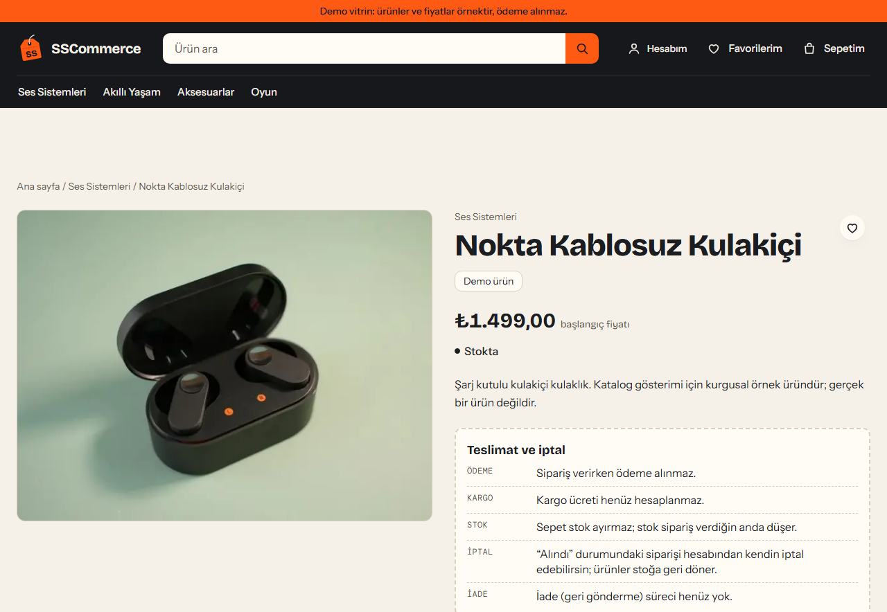<br><sub>Ürün sayfası: teslimat ve iptal koşulları açıkça yazılı</sub></td>
    <td align="center">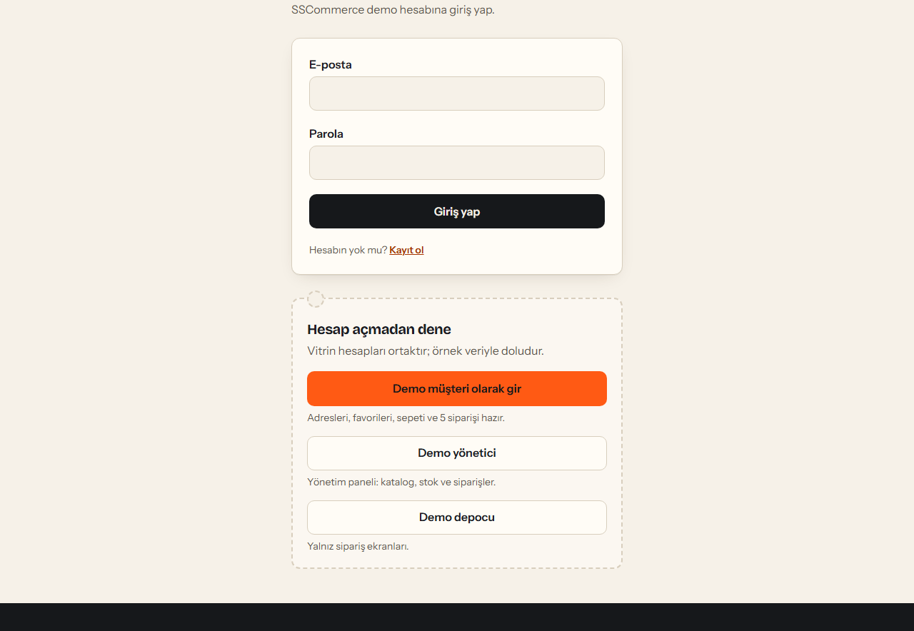<br><sub>Giriş sayfası: tek kolon, altta "Hesap açmadan dene" kartı</sub></td>
  </tr>
  <tr>
    <td align="center">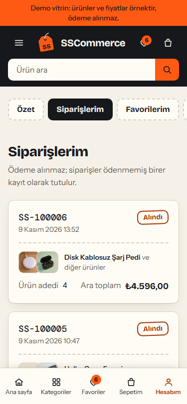<br><sub>Siparişlerim: durum etiketleri</sub></td>
    <td align="center">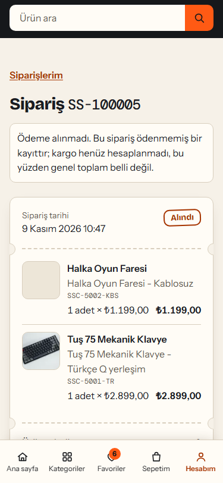<br><sub>Sipariş ayrıntısı: kalemler, zaman çizelgesi, iptal</sub></td>
  </tr>
  <tr>
    <td align="center">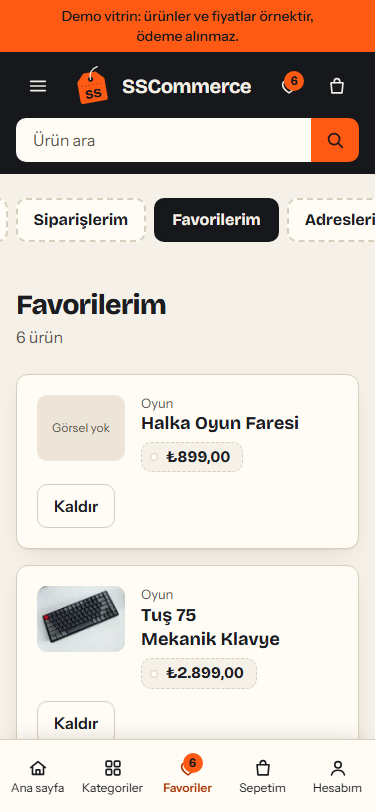<br><sub>Favorilerim</sub></td>
    <td align="center">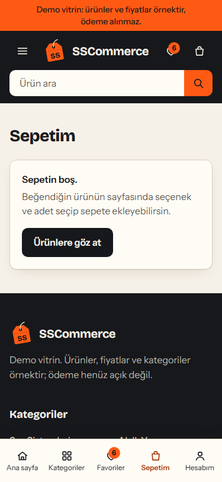<br><sub>Sepet: stok ayrılmaz, uyarı yazılı</sub></td>
  </tr>
</table>

## Yönetim paneli

<p align="center">
  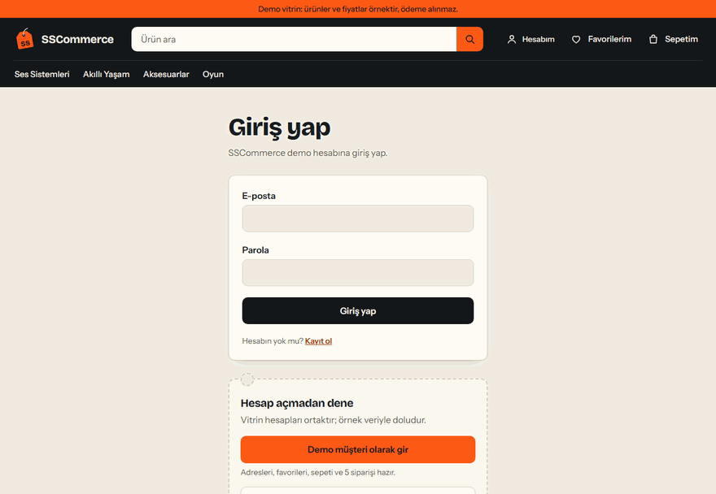
</p>

Rol ve yetki yalnız API'dedir; arayüzdeki `/admin` kapısı yönlendirme kolaylığıdır. Pano "ciro" göstermez: ödeme kaydı olmadığı için yalnız **ödenmemiş açık sipariş ara toplamı** vardır. Ayrıntı: [Yönetim paneli (`/admin`, Faz 8)](#yönetim-paneli-admin-faz-8).

<table>
  <tr>
    <td align="center">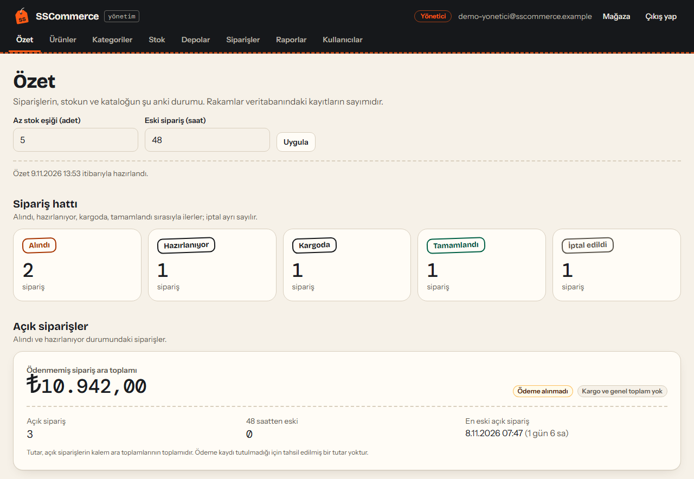<br><sub>Özet: sipariş hattı ve ödenmemiş açık sipariş toplamı</sub></td>
    <td align="center">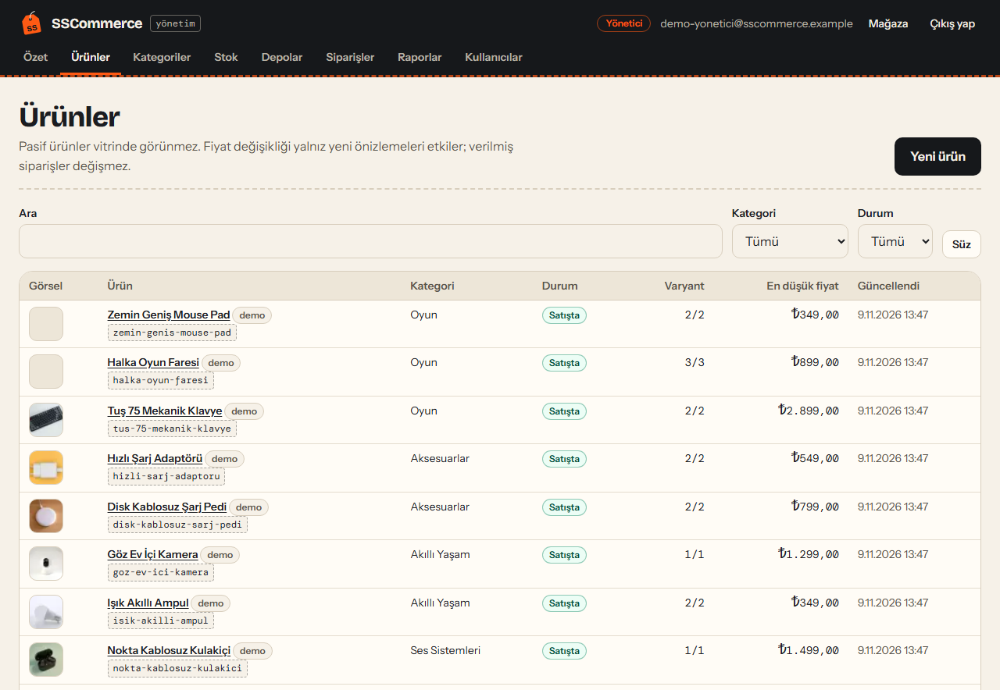<br><sub>Ürünler: durum, varyant sayısı, en düşük fiyat</sub></td>
  </tr>
  <tr>
    <td align="center">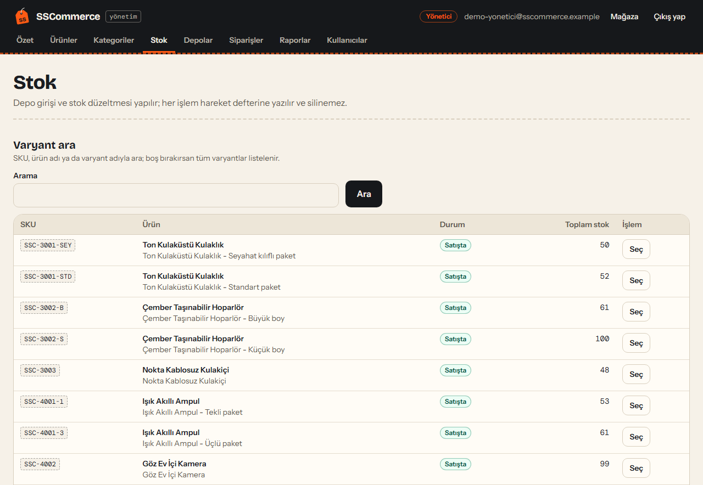<br><sub>Stok: depo bazlı, hareket defteri ile</sub></td>
    <td align="center">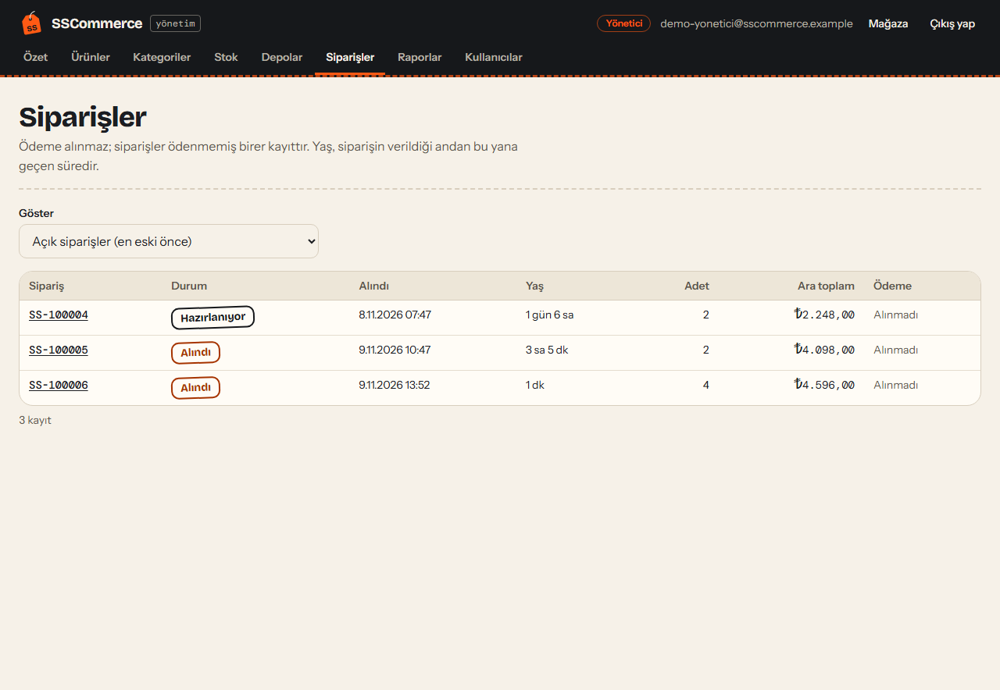<br><sub>Siparişler: durum filtresi, yaş, ara toplam</sub></td>
  </tr>
</table>

## Bilinen sınırlar (vitrin)

- **Canlıya alınmadı.** Proje bir portföy vitrinidir; barındırma, alan adı ve herkese açık TLS yoktur (bkz. [Üretim-eşdeğeri dağıtım](#üretim-eşdeğeri-dağıtım-faz-9)).
- **Vitrin hesapları ortaktır.** Ziyaretçiye özel geçici hesap yoktur (D-092): demo yönetici kataloğu ve stoğu değiştirebilir, değişiklik sonraki demo oturumlarında görünür. `--seed-showcase` tekrar çalıştırılabilir (idempotent) ama yöneticinin yaptığı değişiklikleri geri almaz.
- **Ödeme, iade, kargo hesabı, e-posta doğrulama, parola sıfırlama yok.** Ürünler ve fiyatlar kurgusaldır.
- **Yasal sayfalar** (`/hakkimizda`, `/iletisim`, `/gizlilik-kvkk`, `/mesafeli-satis`, `/cerez-politikasi`) örnek metindir; hukuki danışmanlık değildir. Gerçek bir satıştan önce ürün sahibinin metinleriyle değiştirilmelidir.
- Koyu tema yoktur (açık tema ana temadır).

## Künye

- Görseller ve GIF'ler **gerçek uygulamadan** kaydedildi (2026-11-09): üretim derlemesi (`next build`) + `SSCommerce.E2eHost` API'si (yalıtılmış, tek kullanımlık PostgreSQL 17) + `--seed-showcase`. Hiçbir ekran taklit değildir. Kayıt, Playwright'in Chromium'unda CDP screencast ile yapıldı (kayıpsız kareler, 20 fps GIF).
- Kayıtlar `.\dev -Showcase` ile **alınmadı**: o komut geliştirme veritabanını kullanır ve bu makinede README kaydı için çalıştırılmadı.
- Tüm veri sentetiktir (ürünler, fiyatlar, hesaplar, siparişler). Ürün görsellerinin kaynakları uygulamanın `/gorsel-kaynaklari` sayfasındadır.
- Testler ve kanıtlar: [docs/PROGRESS.md](docs/PROGRESS.md) (vitrin: "Vitrin paketi VT-1..VT-3" ve "VT-3 E2E doğrulaması").

## Neden bu yapı?

- **ASP.NET Core 10 + EF Core 10 + PostgreSQL** (`backend/`): fiyat, stok ve sipariş kuralları gibi iş mantığının tek sahibi.
- **Next.js + TypeScript + Tailwind** (`apps/web/`): vitrin ve ileride `/admin`. İş mantığı içermez, API'yi same-origin proxy üzerinden çağırır.
- Ayrıntılar için: [docs/ARCHITECTURE.md](docs/ARCHITECTURE.md), [docs/DECISIONS.md](docs/DECISIONS.md), [docs/ROADMAP.md](docs/ROADMAP.md). İlerleme kaydı: [docs/PROGRESS.md](docs/PROGRESS.md).

## Gereksinimler

| Araç | Sürüm | Not |
|---|---|---|
| .NET SDK | 10.0.x | `dotnet --version` |
| Node.js / npm | 24.x / 11.x | `node --version` |
| Docker Desktop | 29.x (Compose v5) | PostgreSQL konteyneri için. `docker info` çalışmalı |
| Git | 2.x | |

## Çalıştırma (Windows PowerShell)

> Yalnızca bu makinede gerçekten çalıştırılmış komutlar yazılıdır (bkz. [PROGRESS](docs/PROGRESS.md)).

**Tek komutla (ilk kurulumdan sonra):** proje kökünde `.\dev` → dev veritabanını açar (`docker compose up -d --wait`), API'yi (http://localhost:5080) başlatıp `/health/ready`'yi bekler, sonra web'i (http://localhost:3000) açar; Ctrl+C ikisini birlikte durdurur. `.\dev -Seed` önce demo kataloğu yükler. Parola çalışma anında kök `.env`'den okunur, yazdırılmaz (`dev.ps1`; `dev.cmd` çalıştırma ilkesine takılmadan açar). Aşağıdaki adımlar aynı işin elle yapılışıdır.

### 1. Veritabanı (Docker Desktop)

```powershell
Copy-Item .env.example .env      # sonra .env içindeki parolayı değiştir
docker compose up -d             # PostgreSQL 17, 127.0.0.1:5433, volume: sscommerce-pgdata
docker compose ps                # postgres "(healthy)" olmalı
```

Parola, volume **ilk oluşturulduğunda** veritabanına yazılır. Sonradan `.env`'de değiştirmek mevcut volume'u etkilemez. `.env` kaybolduysa ya da parola değişecekse veriyi silme, rol parolasını döndür (D-058):

```powershell
docker compose exec postgres sh -c 'psql -U "$POSTGRES_USER" -d "$POSTGRES_DB"'   # konteyner soketi parola istemez
# psql içinde: \password sscommerce      (parola sunucuya özet olarak gider, loga düşmez)
# Aynı parolayı .env'e yaz, sonra:
docker compose up -d                                                              # konteyner yenilenir, volume korunur
```

2026-11-01 rotasyonu aynı işi yapan betikle (önceden hesaplanmış SCRAM özeti + `ALTER ROLE`) yapıldı; `\password` bunun elle yapılan karşılığıdır ve bu makinede çalıştırılmadı. `docker compose down -v` **tüm yerel veriyi siler**; yalnız kasıtlı sıfırlama için, yedekten sonra kullan.

### 2. Backend API (http://localhost:5080)

```powershell
dotnet build backend/SSCommerce.slnx -c Release
dotnet test  backend/SSCommerce.slnx -c Release   # DB testleri SSCOMMERCE_TEST_POSTGRES yoksa atlanır (CI'da kalır)

# Bağlantı dizesi yalnızca ortam değişkeniyle verilir; repoya yazılmaz. Parola .env'deki değerdir.
# Host olarak localhost değil 127.0.0.1 kullan: konteyner yalnızca IPv4'e bağlı. Windows'ta "localhost" önce ::1'i
# dener ve reddedilmesi ~2,6 sn sürer; bu da /health/ready'nin 3 sn sınırını aşmasına yol açabilir (DECISIONS D-019).
$env:ConnectionStrings__Postgres = "Host=127.0.0.1;Port=5433;Database=sscommerce;Username=sscommerce;Password=<.env'deki parola>"
$env:SSCOMMERCE_TEST_POSTGRES   = $env:ConnectionStrings__Postgres   # gerçek DB testini de koşturmak için
dotnet tool restore                                    # dotnet-ef (kök .config/dotnet-tools.json)
dotnet ef database update --project backend/src/SSCommerce.Infrastructure --startup-project backend/src/SSCommerce.Api
$env:ASPNETCORE_ENVIRONMENT = "Development"
dotnet run --project backend/src/SSCommerce.Api -- --seed-demo-catalog   # yalnız Development; tekrar çalıştırmak güvenli
dotnet run --project backend/src/SSCommerce.Api --launch-profile http
```

DB testleri `SSCOMMERCE_TEST_POSTGRES` sunucusunda her test grubu için geçici `sscommerce_test_<guid>` veritabanı açar, migration'ları sıfırdan uygular ve sonunda siler. Geliştirme veritabanı `sscommerce`'e dokunmaz (D-029). Bağlantıdaki kullanıcının `CREATEDB` yetkisi olmalı (Compose'taki kullanıcıda var).

| Uç | Ne gösterir |
|---|---|
| `GET /health/live` | Süreç ayakta mı (DB'ye bakmaz) → 200 |
| `GET /health/ready` | PostgreSQL'e gerçekten bağlanır; bağlanamazsa **503** |
| `GET /openapi/v1.json` | OpenAPI belgesi (yalnızca Development) |
| `GET /api/v1/categories` | Aktif kategoriler (anonim) |
| `GET /api/v1/products?category=&q=&minPriceMinor=&maxPriceMinor=&sort=&page=&pageSize=` | Ürün listesi; sort: `newest`, `price_asc`, `price_desc`, `name_asc`; `pageSize` 1–50 |
| `GET /api/v1/products/{slug}` | Ürün detayı, varyantlar (SKU, `priceMinor`), görseller; yoksa 404 |
| `GET /api/v1/auth/csrf` | CSRF token'ı (`X-CSRF-TOKEN` başlığında gönderilir; login/logout sonrası yeniden alınır) |
| `POST /api/v1/auth/register` · `login` · `logout` | Cookie oturumu (HttpOnly). CSRF token'ı zorunlu |
| `GET /api/v1/auth/me` | Oturumdaki kullanıcı; anonimde 401 |
| `GET /api/v1/admin/me` | Yalnız `Admin` rolü (401/403 kontrolü için, yan etkisiz) |

Kayıt her zaman `Customer` rolü verir. Varsayılan admin hesabı yoktur ve rol yükseltmenin HTTP yolu yoktur (D-032). E-posta doğrulama ve parola sıfırlama henüz yok (D-036).

Üretim için gerekli ayarlar: `Security__AllowedOrigins__0=<site origin'i>` (boşsa tarayıcı POST'ları 403 alır), `DataProtection__KeysPath=<repo dışında kalıcı dizin>` (yoksa yeniden başlatmada oturumlar düşer), API'nin önünde TLS sonlandıran ters proxy ve gerekirse `Security__TrustedProxies__*`. API doğrudan internete açılmaz.

Bağlantı dizesi tanımlı değilse API yine açılır; `/health/ready` 503 döner. Bu doğrulandı.

### 3. Web (http://localhost:3000)

```powershell
cd apps/web
npm ci
npm run dev            # geliştirme
npm run lint
npm run typecheck      # tsc --noEmit
npm run build
npx playwright install chromium   # ilk seferde
# Backend bölümündeki SSCOMMERCE_TEST_POSTGRES bu kabukta da tanımlı olmalı.
npm run test:e2e       # API_BASE_URL=5081 ile build + izole gerçek API/DB + Playwright
npm run test:server    # soket IP'si / güvenilen proxy zinciri
npm run test:proxy     # gerçek Next -> API rate limit, sahte XFF ile sınır aşılamaz
```

Web, `/api/backend/*` isteklerini `API_BASE_URL` adresine (varsayılan `http://localhost:5080`) iletir (`apps/web/.env.example`). Katalog Server Component'ları API'yi `no-store` ile sunucudan okur; tarayıcıdaki auth istekleri same-origin proxy kullanır. `/status` backend health durumunu gösterir. E2E için `npm run test:e2e` API adresini build ve test sunucusunda **5081** yapar; normal geliştirmeye dönerken normal API adresiyle yeniden build alın. `npm run e2e` CI'daki mevcut E2E build'ini kullanır.

Mağaza, kategori, arama (fiyat/kategori/sıralama/sayfalama) ve `/urun/{slug}` gerçek katalog API'sine bağlıdır. `/kayit`, `/giris`, `/hesabim` aynı origin'de cookie + CSRF ile çalışır. Sekiz kategori görseli korunur; demo seed'deki dört kategori kullanılabilir, diğer kartlar Yakında'dır. API kapalıyken ürün fixture'ına dönülmez. Hesap yanıtları `no-store`; şifre/token localStorage'a yazılmaz. E-posta doğrulama henüz sunulmaz.

Sepet, teslimat adresleri (`/hesabim/adresler`) ve teslimat özeti (`/checkout`) giriş gerektirir ve gerçek API'ye bağlıdır. Sepet stok ayırmaz; tutarları sunucu güncel fiyattan hesaplar. `/checkout` kargo hesaplanmadığı için ödenecek toplam göstermez.

Sipariş `/checkout` üzerinden verilir, `/siparisler` ve `/siparisler/{id}` sayfalarında izlenir. **Ödeme alınmaz:** sipariş ödenmemiş bir kayıttır, kargo ve genel toplam hesaplanmaz, stok sipariş anında düşer ve kendiliğinden geri dönmez. Müşteri yalnız `placed` durumundaki kendi siparişini iptal eder; stok özgün depoya döner.

Demo katalog için stok seed edilmez (D-047), yani yeni kurulumda her ürün "Stokta yok" görünür ve sepete eklenemez, bu yüzden geliştirme ortamında sipariş verilemez. Stok yalnız Admin rolüyle `POST /api/v1/admin/inventory/receive` üzerinden girilir; varsayılan admin hesabı yoktur ve admin arayüzü Faz 8'dedir. Tarayıcıda stoklu akışı görmek için E2E ortamı kullanılır: sabit stok verisini `SSCommerce.E2eHost` kurar.

### Web giriş katmanı ve güvenilen proxy

`npm run dev` ve `npm start`, `server.mjs` içinden Next.js'i açar. Varsayılan dinleme adresi `127.0.0.1` (`WEB_HOST` ile değişebilir). Gerçek TCP peer adresi, istemcinin sağladığı XFF'nin üzerine yazılır; böylece tarayıcı sahte XFF ile rate limit kovası seçemez. `WEB_TRUSTED_PROXIES` boş bırakıldığında gelen hiçbir proxy zincirine güvenilmez. Yalnız gerçek ingress socket IP'lerini virgülle listeleyin; bu peer'den gelen zincir sağdan sola ilk güvenilmeyen adreste durur. Örnek: `WEB_TRUSTED_PROXIES=10.0.0.2`. Loopback'i listeye eklemek yerel istemcilere forwarding yetkisi verir; varsayılan değildir.

Üretimde TLS ters proxy dışarı açık olur, Next ve API özel ağda kalır. Ingress başlıklarını ve gerçek peer adresini doğrulayın; rastgele kullanıcı başlıklarına güvenmeyin. API tarafındaki `Security__TrustedProxies__*`, web sunucusunun API'ye bağlandığı adresleri tanımlar; web tarafındaki listeyle aynı görev değildir. Custom server `output: standalone` ile kullanılmaz. Gerekçe ve kaynaklar: D-042, [Next custom server](https://nextjs.org/docs/app/guides/custom-server), [ASP.NET Core forwarded headers](https://learn.microsoft.com/en-us/aspnet/core/host-and-deploy/proxy-load-balancer).

Browser testleri `backend/tools/SSCommerce.E2eHost` ile sıfırdan `sscommerce_test_<guid>` açar, bütün migration'ları, demo seed'i ve test stoğunu uygular, test sonunda yalnız kendi DB'sini temizler. Fiyat ve stok değiştiren senaryolar için yalnız loopback'te açılan kontrol ucu (`127.0.0.1:5082`) bu araçtadır; API'de böyle bir uç yoktur. Mevcut geliştirme verisi değişmez. API yalnız test child process'inde yüksek rate limit alır; `test:proxy` ayrı DB ve düşük sınırla gerçek sınırlamayı doğrular. Ani OS/process kill durumunda kalan test DB'si otomatik başarı sayılmaz; normal teardown temizliğin onayını bekler.

## Yönetim paneli (`/admin`, Faz 8)

`/admin` aynı Next.js uygulamasında, vitrinden ayrı bir düzenle açılır (11 rota): pano, ürünler (oluştur/düzenle/aktiflik/fiyat/görseller), kategoriler (ağaç), stok, depolar, siparişler ve ayrıntısı, raporlar, kullanıcılar. Sözleşme: [`docs/CONTRACT_PHASE_8.md`](docs/CONTRACT_PHASE_8.md).

| Rol | Yapabildikleri |
|---|---|
| `Admin` | Katalog, stok, depo, pano, rapor, denetim kaydı, kullanıcı/rol yönetimi, bütün sipariş geçişleri (iptal dahil), teslimat bilgisini görüntüleme (her görüntüleme denetim kaydı bırakır) |
| `Warehouse` | Yalnız sipariş listesi/ayrıntısı ve **ileri** geçişler (hazırlama, kargo, teslim). İptal, katalog, stok, pano, rapor ve teslimat adresi/telefonu yok (D-071: Warehouse'a teslimat verisi açmak sahip kararı bekliyor) |
| `Customer` | Yalnız kendi alışverişi ve siparişleri; `/admin` 403 |

Yetki yalnız API'dedir. Arayüzdeki `/admin` kapısı (`src/proxy.ts`) yönlendirme kolaylığıdır, güvenlik sınırı değildir.

**İlk Admin (güvenli kurulum).** Varsayılan Admin hesabı ve HTTP üzerinden Admin yapma yolu yoktur. Önce `/kayit` ile normal bir hesap açın, sonra yerel makinede, **yalnız Development ortamında ve loopback veritabanına karşı**:

```powershell
$env:ASPNETCORE_ENVIRONMENT = "Development"
dotnet run --project backend/src/SSCommerce.Api -- --bootstrap-admin
```

Komut kayıtlı hesabın e-postasını iki kez ister (parola istemez, yazdırmaz, loglamaz), yalnız hiç Admin yokken çalışır ve tek transaction'da rolü verir, oturumları iptal eder, denetim satırı yazar. Sonra hesapla yeniden giriş yapın. Sonraki personel için Admin, kişinin `/hesabim` sayfasındaki **hesap kimliğini** (e-posta değil) alıp rol API'sini ya da `/admin/kullanicilar` ekranını kullanır. Son Admin kendi rolünü kaldıramaz.

**Pano göstergeleri.** Sipariş sayıları durum bazlıdır. "Ödenmemiş sipariş ara toplamı" yalnız açık (`placed`+`processing`) siparişlerin kalem toplamıdır; **ciro, gelir ya da tahsilat değildir** (ödeme kaydı yoktur), kargo ve genel toplam yoktur. Stok göstergeleri satılabilir varyantlar (varyant, ürün ve kategori aktif) ve aktif depolar üzerinden hesaplanır.

**Ödenmemiş sipariş sınırları.** Hesap başına en çok 3 açık sipariş (`409 open_order_limit`) ve kayan 24 saatte en çok 10 sipariş (`429 order_daily_limit`, `Retry-After` ile). Ayarlar `Ordering__MaxOpenOrdersPerUser` ve `Ordering__MaxOrdersPerRollingDay`. Üretim eşikleri sahip onayı bekliyor (`PRODUCTION_ORDERING_POLICY_PENDING`).

**Üretim önkoşulları (Faz 8'in eklediği/vurguladığı).**
- `WEB_TRUSTED_PROXIES` (web) ve `Security__TrustedProxies__*` (API) birbirine uygun ayarlanmalıdır. Web'in önünde gerçek bir ters proxy varken `WEB_TRUSTED_PROXIES` boş kalırsa istemci IP'si okunamaz ve hız sınırı kovası bütün istemciler için tek olur (sağlık kapısında gözlendi).
- `--bootstrap-admin` HTTP ucu değildir; yalnız Development + loopback korumalıdır. Üretim-eşdeğeri yığında `deploy/scripts/api-command.sh` ile, DB konteynerinin ağ ad alanına katılan tek kullanımlık konteynerden çalıştırılır (D-083).
- Gerçek ödeme, iade, e-posta doğrulama ve parola sıfırlama yoktur. CSP Faz 9'da eklendi (nonce+hash; `style-src-attr 'unsafe-inline'` bilinen Low, D-081).
- Veritabanı: yeni migration `AddAdminOperations` yalnız ekleyicidir. Mevcut bir veritabanına uygulamadan önce `pg_dump -Fc` yedeği alın; dev veritabanında uygulama sahibinin onayına bağlıdır.

## Üretim-eşdeğeri dağıtım (Faz 9)

Yalıtılmış yerel yığın (Caddy TLS → Next `server.mjs` → ASP.NET → PostgreSQL 17, Docker Compose): [docs/DEPLOYMENT.md](docs/DEPLOYMENT.md). İşletim (yedek/geri yükleme, sorun giderme, uyarılar): [docs/OPERATIONS.md](docs/OPERATIONS.md). Kanıtlar: [docs/PHASE_9_VERIFICATION.md](docs/PHASE_9_VERIFICATION.md); güvenlik: [docs/SECURITY_REVIEW_PHASE_9.md](docs/SECURITY_REVIEW_PHASE_9.md); ne yapar/yapmaz: [docs/RELEASE_NOTES.md](docs/RELEASE_NOTES.md).

```sh
sh deploy/scripts/gen-env.sh                                  # rastgele sırlar (ekrana yazılmaz)
docker compose -f deploy/compose.yml --env-file deploy/.env.stack up -d --build
```

Dev yığınından (kök `docker-compose.yml`, 5433) ayrıdır. **Herkese açık sipariş varsayılan KAPALI** (`ORDERING_ENABLED=false`; sunucuda 503): ödeme yok, stok rezervasyonu otomatik sona ermez; açmak sahibin iş-riski kararıdır. Barındırma/alan adı/herkese açık TLS ve hosted CI **doğrulanmadı** (`BLOCKED_EXTERNAL`).

## Henüz yapılmayanlar

- Faz 9 (üretim hazırlığı) yerel üretim-eşdeğeri yığında doğrulandı; gerçek barındırma, herkese açık TLS ve hosted CI sahip eylemi/dış bağımlılık bekliyor. ERP/Admin (8) push edildi (`c8bba63`). Ayrıntı: [ROADMAP](docs/ROADMAP.md). Vitrindeki ürünler ve fiyatlar **demo verisidir**; ödeme yoktur.
- MVP dışı: gerçek ödeme entegrasyonu ve stok rezervasyonu.
- Uzak CI: GitHub hesabının faturalandırma kilidi yüzünden çalışmıyor (BLOCKED_EXTERNAL); bütün kontroller yerelde koşuluyor.
